<picture>
  <source media="(prefers-color-scheme: dark)" srcset="assets/banner-dark.svg">
  
</picture>

I'm a computer science senior with a minor in machine learning and AI. I like projects built on real data, and I run [Bravix Media](https://bravixmedia.com), where I build the ad and lead systems for home service contractors.

### Building now

- **F1 race strategy simulator.** Replays a real Formula 1 race with a different pit stop and predicts where the driver would have finished. Live telemetry from OpenF1 and Jolpica, a bronze/silver/gold lakehouse on Azure Databricks, and a lap-time model trained on 2023-2025 races. *(class project, public once it's graded)*
- **Bravix Hub.** Private dashboard for my agency. Pulls live campaign data from the Meta Graph API, flags what to kill or scale, and posts alerts to Slack every hour. Next.js on Vercel.
- **Client websites.** Fast static sites built with Astro, deployed on Cloudflare.

### Shipped

- [tcp-multithreaded-chat-server](https://github.com/zaidalssaraj/tcp-multithreaded-chat-server): multithreaded TCP chat server in Java
- [udp-multithreaded-chat-server](https://github.com/zaidalssaraj/udp-multithreaded-chat-server): UDP chat server in Java, one thread per datagram with a synchronized message counter

### Tools I use

`Python` `Java` `TypeScript` `SQL` `Spark` `Databricks` `Azure` `Next.js` `Astro` `Cloudflare` `Vercel`

### Find me

[LinkedIn](https://www.linkedin.com/in/zaidalssaraj/) · [bravixmedia.com](https://bravixmedia.com)
